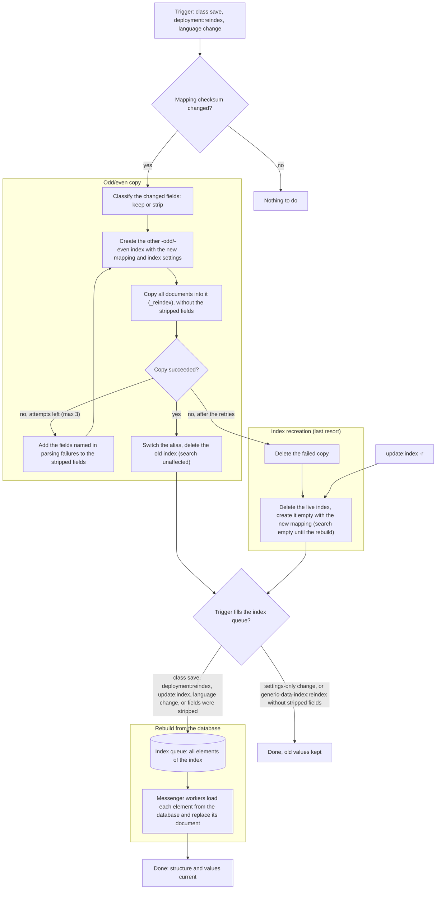

# Reindexing Guide

This guide describes which changes to a Pimcore installation require a reindex of the Generic Data Index, which of
them are handled automatically, and which command to run for the rest. For the configuration of indices, the index
queue and the individual commands see [Index Management](../02_Configuration/03_Index_Management.md).

A reindex is needed in two cases:

- The index **mapping** changes: fields, field types, languages or index settings.
- The **indexed values** go stale because data changed without the element being saved.

The bundle handles only two kinds of change automatically: saving a class definition, and changing the valid
languages in the system settings. Everything else needs one of the commands described below, usually
`generic-data-index:deployment:reindex` as part of the deployment.

Commands are written without their `generic-data-index:` prefix in this guide (`update:index`,
`deployment:reindex`), except `generic-data-index:reindex`, which is always written in full to tell it apart from
the general term "reindex". `<id>` stands for a class definition ID.

## At a Glance

| Change | Reindex needed? | Automatic? | Command if manual |
| --- | --- | --- | --- |
| Field added, removed or renamed in a class (admin UI or Studio) | Yes: mapping | Yes | None |
| Field type changed to one with a different index type (e.g. input to numeric) | Yes: mapping; the index is copied, not recreated (recreation only as a last resort), the changed field is empty (or keeps its old value) until the rebuild | Yes | None |
| Field type changed within the same index type (e.g. input to textarea) | No | Not needed | None |
| Allowed field collection or object brick types changed in a class field | Yes: mapping | Yes | None |
| Table column config, structured table rows/columns, or advanced many-to-many columns changed | Yes: mapping | Yes | None |
| Field moved into or out of localized fields or a block | Yes: mapping | Yes | None |
| Class definition deployed and `pimcore:deployment:classes-rebuild` run | Yes, if the mapping changed | Only for classes whose definition `modificationDate` changed | `deployment:reindex` as a safety net |
| Class definition files deployed without a rebuild | Yes, if the mapping changed | No | `deployment:reindex` |
| Field collection definition changed | Yes: mapping of every class using it | No | `deployment:reindex` |
| Object brick fields changed | Yes: mapping of every class using it | No | `deployment:reindex` |
| Object brick assigned to or removed from a class | Yes: mapping | Yes (Pimcore saves the class) | None |
| Classification store group or key added, renamed, retyped or removed | Yes: mapping of every class with that store | No | `deployment:reindex` |
| Valid languages added or removed in the system settings (admin UI or Studio) | Yes: every index, every element | Yes | None |
| Only the language order changed in the system settings | Not needed, but a full reindex runs anyway | Yes | None (avoid on large installations) |
| Valid languages changed in config files (usual in production) | Yes: classes with localized fields and the asset index | No | `deployment:reindex --all` |
| Calculator code changed (`calculated_fields_index_mode: live`) | Yes: values | No | Raise `index_versions.classes.<id>`, then `deployment:reindex --classes` |
| Calculator code changed (`query_store` mode) | Yes: values | No | Re-save the objects |
| Data a calculated value depends on changed (another object, external service) | Yes: values | No | Re-save the object, or `update:index -c <id>` |
| Predefined asset metadata definition added, changed or removed | Yes: asset mapping and values | No | `deployment:reindex --assets` |
| Tag moved to another parent tag | Yes: `parentTags` values | No | `update:index` |
| Tag with child tags deleted, or tag deleted that was assigned to documents | Yes: `tags` values of the affected elements | Partly (assets and data objects with the exact tag) | `update:index` |
| Element copied | Yes: the copy's tags | No | Re-save the copy, or `update:index` |
| Reverse object relation changed by saving the referenced object | Yes: values of the objects pointing to it | No | Re-save them, or `update:index -c <id>` |
| Data written by SQL, DAO methods or raw imports | Yes: values | No | `update:index -c <id>` or `-a`; `update:index` for documents |
| Workflow place permissions changed | Yes: `hasWorkflowWithPermissions` values | No | `update:index` |
| Custom `ExtractMappingEvent` subscriber added or changed | Yes: mapping | No | `deployment:reindex` (classes), `--assets` or `--documents` |
| Custom `UpdateIndexDataEvent` subscriber or custom field definition adapter changed | Yes: values | No | Raise the matching `index_versions` entry, then `deployment:reindex --all` |
| `index_settings` changed (analysis, `max_result_window`, `mapping.total_fields.limit`) | Yes: new index | No | `deployment:reindex --all` |
| Bundle upgrade with a mapping change in the [upgrade notes](../01_Installation/02_Upgrade.md) | Yes | No | `deployment:reindex --all` or as stated in the notes |

## How Reindexing Works

Four mechanisms update an index. A trigger usually chains two of them: a mapping step (in-place mapping update,
odd/even copy or index recreation) followed by a rebuild from the database, which refreshes the values. The mapping
step alone leaves the old values in place. Only settings-only changes and `generic-data-index:reindex` without
stripped fields stop after the mapping step; the table under [Which Trigger Does What](#which-trigger-does-what)
shows the chain per trigger.

| Mechanism | What happens in the search engine | Data source | Search during the run |
| --- | --- | --- | --- |
| In-place mapping update | `PUT _mapping` on the live index. Adds new fields only: removed fields stay mapped, a type change is rejected and triggers an odd/even copy instead. Index settings are not applied. | Existing documents, unchanged | Unaffected |
| Odd/even copy | The engine copies all documents into the other `-odd`/`-even` index, created with the current mapping and the current `index_settings` (`_reindex`), then the alias is switched and the old index deleted. Fields whose old values don't fit the new type are left out of the copy; the other changed fields are kept. The documents are never emptied. [Index Management](../02_Configuration/03_Index_Management.md#why--odd-and--even-suffixes) and the `generic-data-index:reindex` command call this *native reindexing*. | Existing documents, copied | Unaffected: reads go to the old index until the switch |
| Index recreation | The live index is deleted and created again empty with the new mapping. The last resort: runs automatically only when the odd/even copy still fails after the retries; `update:index -r` always recreates. | None: the index is empty until the rebuild has filled it | Empty or incomplete until the rebuild has finished |
| Rebuild from the database | The affected elements are added to the index queue; messenger workers load each one from the database and replace its document. | Database | Values update as the index queue is processed |

Before the copy, the bundle compares the live mapping with the new mapping and sorts every changed field:

- **Kept** if the old values still fit: any scalar type to text or keyword, numeric widening (integer to long or
  double, long to double, float to double), and object to nested or back. The field keeps its old value, for example
  a number as text, until the rebuild from the database.
- **Stripped** in all other cases: the field is removed from every document in the copy and stays empty until the
  rebuild. This includes numeric to date, because the engine would read the number as epoch milliseconds, and double
  to long, which would truncate the decimals. Date, datetime and time fields differ only in their date format, so a
  change between them, or switching "respect timezone" on or off, strips the field unless the new format still lists
  every old format.

Class fields and custom fields (added by `ExtractMappingEvent` and `UpdateIndexDataEvent` subscribers) can be stripped;
the rebuild from the database fills both again. System fields are never stripped, because a document without its id or
class breaks search results: a changed system field is copied as it is, and if its old values don't fit the new type,
the copy fails and the index is recreated as a last resort. The same applies to fields outside the class and custom
fields, such as dynamically mapped root fields. `--dry-run` lists such fields as "fields outside class and custom fields
copied as they are".

If the engine still reports a parsing failure for a field, the bundle adds that field to the stripped fields and
retries the copy, up to 3 attempts. Only if the copy still fails after that is the index recreated. Every attempt is
a full copy of the index, and the engine names one failing field per document of the first failing batch, so a large
index can spend several copy durations before the alias switches. Run type changes on large classes in a quiet period
with enough workers; the live index serves reads throughout. The failure messages this relies on were verified on
OpenSearch 2 and Elasticsearch 8.5; on an engine that words them differently, the copy falls back to the recreation
after the first attempt, as before.

The bundle creates indices with the engine defaults for `dynamic`, `coerce` and `ignore_malformed`. During an odd/even
copy this means:

- Numbers copied into a `keyword` field and numeric strings copied into a number field are accepted.
- Decimals copied into an integer field are accepted but truncated, unless the field is a changed field: a double to
  long change strips the field instead.
- Text copied into a number, date or boolean field doesn't fit: a class or custom field is stripped instead of the index
  being recreated.
- Fields that are no longer in the mapping are re-mapped dynamically and stay in the mapping until the index is
  recreated with `update:index -r`. If their values don't fit the re-mapped type (for example "2026-01-01" in one
  document and "abc" in the next), all removed class and custom fields are left out of the copy.

Whenever fields were stripped, or the index had to be created empty, the bundle adds all elements of that index to the
index queue, even if the trigger doesn't rebuild otherwise. Search keeps working during this; only the stripped fields
are empty until the messenger workers have processed the queue.

### Flow of a Mapping Change

The chart shows what happens after a trigger detects a mapping change, for example a class save or
`deployment:reindex`, and where the index recreation comes in: as the last resort when the copy still fails after
the retries, or explicitly through `update:index -r`. The odd/even copy produces a complete index in the new
structure, with the old values except in the stripped fields; the rebuild from the database afterwards refreshes the
values, and only some triggers run it.



### Which Trigger Does What

| Trigger | In-place | Odd/even copy | Index recreation | Rebuild from the database | Applies new `index_settings`? |
| --- | --- | --- | --- | --- | --- |
| Class save (admin UI, Studio, `classes-rebuild`) | — | If the mapping checksum changed | Last resort | That class | Only if reindexed |
| `deployment:reindex` without options | — | Classes with a changed or missing checksum | Last resort | Those classes | Only for those classes |
| `deployment:reindex --all` (or an index option) | — | Indices with a changed mapping or changed settings | Last resort | Indices with a changed mapping or data version | Yes |
| `update:index` (`-c`, `-a`) | Always | If `PUT _mapping` is rejected | Last resort | Everything in scope | No |
| `update:index -r` | — | — | Always | Everything in scope | Yes |
| `generic-data-index:reindex` | — | Every class, asset and document index, forced | Last resort | Only for indices with stripped fields or a recreated index | Yes, without downtime |

:::warning

Risk of odd/even copying:

- **Changes made while `_reindex` runs.** The engine copies a snapshot, and writes keep going to the old index, so
  elements saved during the copy are missing from the new index. A rebuild from the database afterwards repairs
  updates and inserts. Deletes made during the window are not repaired: deleted elements remain in the index until
  the next `update:index -r`. Run odd/even copies in a quiet period, ideally with the messenger workers stopped.
:::

:::info

`generic-data-index:reindex` queues the indices that need it. If its odd/even copy stripped fields, or the index had
to be created empty, all elements of that index are added to the index queue and the command prints a notice. Run the
messenger workers to fill them. Other indices are not queued.

:::

## Class Definition Changes

Saving a class definition reindexes only when the class's **mapping checksum** changes. The bundle then runs an odd/even
copy of the class index, followed by a rebuild from the database of all its objects. A field type change doesn't
recreate the index: fields whose old values still fit are kept, all other changed fields are stripped from the copy, and
the index is only recreated as a last resort (see [How Reindexing Works](#how-reindexing-works)).

Changes that alter the mapping (automatic reindex on save):

- Adding, removing or renaming a field. The index key is the field name, so a rename counts as a remove plus an add.
  A new field's default value needs no rebuild: Pimcore applies defaults only when an object is created, so existing
  objects stay empty.
- Changing a field's data type to one with a different index type (see the table below).
- Changing the **allowed types** of a field collections or object bricks field.
- Changing a table's **column config** (when activated), or a structured table's rows and columns.
- Changing the **metadata columns** of an advanced many-to-many relation.
- Changing the children of a **block**, or moving a field into or out of **localized fields**.

Changes that don't alter the mapping (nothing is reindexed): title, tooltip, layout and panels, mandatory or
invisible flags, permissions, select options, allowed classes on relations, the calculator class, and switching
between data types that share an index type. The class icon is updated in the index in place.

| Index type | Data types that share it (switching between them needs no reindex) |
| --- | --- |
| Text + keyword | input, textarea, wysiwyg, select, multiselect, country, countrymultiselect, language, languagemultiselect, password, user, firstname, lastname, email, gender, calculatedValue |
| Numeric (`float`) | numeric, slider. In 2026.x these fields are mapped as `double`, or `long` with the integer option, so toggling the integer option changes the mapping there. |
| Boolean | checkbox, booleanSelect |
| Relation | manyToOneRelation, manyToManyRelation, manyToManyObjectRelation, reverseObjectRelation |
| Advanced relation | advancedManyToManyRelation, advancedManyToManyObjectRelation |
| Geo point | geopoint, geopolygon, geopolyline |
| Own type each | date, datetime, dateRange, time, quantityValue, inputQuantityValue, quantityValueRange, numericRange, rgbaColor, geobounds, urlSlug, link, consent, image, hotspotimage, imageGallery, externalImage, video, table, structuredTable, block, localizedfields, fieldcollections, objectbricks, classificationstore |

Data types not in this table (for example encrypted fields) are not indexed; adding or removing them doesn't change
the mapping.

### Deployments

The bundle reacts only to Pimcore's class definition add, update and delete events:

- `pimcore:deployment:classes-rebuild` fires these events, but only for classes whose definition file
  `modificationDate` differs from the database (or for every class with `-f`). With `-d` it fires the delete event
  for classes whose file is gone.
- Nothing fires if class files are deployed without running the rebuild, if a file was edited without changing its
  `modificationDate`, or if the database is already current and only the PHP class files are regenerated (for
  example on a second node).

Run `deployment:reindex` after every deployment as a safety net. It recalculates every class checksum and reindexes
only classes that differ or have no stored checksum yet. See [Deployment and Index
Management](../02_Configuration/03_Index_Management.md#deployment-and-index-management).

## Field Type Changes

What a field type change does to the index depends on `index_service.reindex_settings.mapping_change_strategy` (see
[Reindex Options](../02_Configuration/03_Index_Management.md#reindex-options)):

- **`recreate`** (default): the documents are copied as they are into the other odd/even index. If their old values
  fit the new mapping (for example a number that becomes text), the copy succeeds and nothing else happens. If they
  don't (text that becomes a number), the index is recreated empty with the new mapping and every element of the
  index is queued for a rebuild from the database: listings and searches of the class find nothing until the messenger
  workers have processed the queue. `deployment:reindex --dry-run` names the changed fields and which of them the
  `copy` strategy would leave out, so the outcome is known before the deployment.
- **`copy`**: the odd/even copy keeps the fields whose old values still fit and strips the others, so the alias
  switches and every document stays in the index. The changed fields are the exception, for as long as the rebuild
  from the database takes, as described in the rest of this section.

The following applies to the `copy` strategy:

- A **stripped** field is absent from every document until the rebuild has refilled that object. Filters on that
  field match nothing, sorting on it puts every object last, and aggregations on it are empty. Negative filters are
  the exception: "is empty", `must_not` or "not equal" on the field match every document during that time. If project
  code hides documents with a negative filter on a class field (for example `must_not` on a "hidden" flag), those
  documents show up until the rebuild; the bundle's own permission and workspace filters use system fields only and
  are not affected. A stripped copy also drops the stored document checksum, so the rebuild rewrites every document.
  Everything else about the documents is unchanged.
- A **kept** field holds its old value in the new type, for example a number as text or a date as its ISO string,
  until the rebuild. Only the rebuild writes the value as Pimcore converted it in the database. A class save,
  `deployment:reindex` with a mapping change and `update:index` run that rebuild; `generic-data-index:reindex` and a
  settings-only `deployment:reindex` don't, so after those the old value stays until the object is saved or
  `update:index -c <id>` runs.
- The index is recreated, and empty, only as a last resort when the copy still fails after the retries.

How long the changed fields stay empty is the time the messenger workers need to process all objects of the class,
not the time of the copy. It grows with the number of objects and shrinks with the number of workers (see
[Index Queue Options](../02_Configuration/03_Index_Management.md#index-queue-options)). The rebuild is queued
automatically; run enough workers and check `generic-data-index:status` to see when the index queue has drained.
Fields that are only found during the copy, for example values that fit the old mapping but not the new one, are
stripped as well and named in the log; `--dry-run` cannot list them in advance.

The copy itself costs about as much as the odd/even copy did before this change, and the messenger worker that
handles the class mapping message is blocked for its duration. Measured on a development machine (OpenSearch 2 with
a 1 GB heap, documents of 63 fields and about 6 KB): copying 100,000 documents took about 2 minutes and 300,000
about 6 minutes, roughly 1.2 ms per document, whether 1 field was stripped or none. Stripping is not what costs; the
copy time follows the amount of data written to the new index, so a copy that strips most of each document is faster
(60 of 63 fields stripped: 15 s and 30 s). A retry repeats the full copy. The rebuild afterwards runs at the usual
indexing rate of the workers (about 300 documents per second per worker on that machine).

The rebuild refills a field only for objects whose database value fits the new type. Pimcore keeps values that don't
fit, for example a time truncated from a datetime or relation metadata text in a column that is now numeric, and
such an object fails its whole queue batch: the batch lands in the failed transport, and its queue entries are
dispatched again after 24 hours. If a changed field stays empty for some objects, check the failed messages (see
[Handling Failed Messages](../02_Configuration/03_Index_Management.md#handling-failed-messages)) and fix the data.

### Expand and Contract for Fields That Must Stay Searchable

If a field must stay searchable without interruption, treat a type change like a database column migration: add the
new field, move the data, switch the consumers, remove the old field. Every step is an additive mapping change, so
this works with either strategy.

1. **Add** a new field with the target type (for example `priceNumeric` next to `price`). Saving the class
   triggers an odd/even copy; the new field is empty.
2. **Fill** it: a one-off script that converts the old value and saves each object, or an import. Each save
   reindexes the object. For large classes, batch the saves and disable versioning for the run.
3. **Switch** the consumers to the new field: code, grid configurations, Studio listings, PQL filters and
   Data Hub queries.
4. **Remove** the old field. The copy succeeds, because a removed field is re-mapped dynamically, and the
   following rebuild drops it from the documents. Its mapping entry stays until the index is recreated with
   `update:index -r`; schedule that for a quiet period, or leave it.

A field rename works the same way, because the bundle treats it as a remove plus an add.

### Test the Change Before the Production Deployment

Apply the class change on a staging system with production-like data. `deployment:reindex --dry-run` lists per index
the fields stripped and the fields kept in the copy (with `recreate`: the changed fields copied as they are, and
which of them `copy` would leave out). After the real run, check the log of the `pimcore_generic_data_index` channel:

- The info line `Copying "..." into a new index with changed fields` lists the stripped and kept fields (with
  `recreate`: the changed fields, copied as they are).
- A warning that parsing failures named fields the diff missed means the bundle found further fields during the copy.
- The warning `Recreating index for alias "...": the new mapping is incompatible with the indexed documents` is the
  expected outcome of an incompatible change with `recreate`, and the last-resort case with `copy`. If you see it,
  the same change will empty the index in production.

## Field Collections, Object Bricks and Classification Store

These definitions are part of the mapping of every class that uses them, but most changes to them fire no class
definition event. The changes marked "manual" below need `deployment:reindex`, which recalculates every class
checksum and therefore finds the classes affected indirectly.

| Definition | Change | Automatic? | Classes affected |
| --- | --- | --- | --- |
| Field collection | Any field change (add, remove, rename, type, nested table or block config) | Manual | Every class with a field collections field allowing it |
| Object brick | Field change (add, remove, rename, type, localized fields inside the brick) | Manual | Every class with an object bricks field allowing it |
| Object brick | Brick added to or removed from a class's allowed types, or brick deleted | Automatic (Pimcore saves the class) | The classes whose assignment changed |
| Classification store | Group added, renamed or removed; key added, renamed, removed or type changed; key moved between groups | Manual | Every class with a classification store field using that store |

Why these changes are not detected: a field collection save only fires `FieldcollectionDefinitionEvents` and
updates the database tables of the classes using it; an object brick save saves a class only when its class
assignment changes; classification store groups, keys and stores fire their own
`DataObjectClassificationStoreEvents`, and key–group relations fire no event at all. The bundle listens to none of
them. This applies to the admin UI, Studio and `classes-rebuild` alike.

Until `deployment:reindex` has run, the class indices keep the old mapping, so new or retyped fields in these
definitions are not searchable or filterable as intended.

## Languages

Adding or removing a valid language always requires a reindex of every class with localized fields and of the asset
index; the document and folder indices don't depend on the language list. Localized fields are mapped once per
valid language (`standard_fields.<field>.<language>`), including localized fields inside object bricks, and predefined
asset metadata is mapped per language as well.

- **Changed in the system settings (admin UI or Studio):** automatic. The bundle compares the old and new language
  lists and, if they differ, runs a forced odd/even copy of every class, asset and document index, then adds every
  element to the index queue. On large installations this is the most expensive change there is: plan it for a
  quiet period and run enough messenger workers.
- **Only the order changed in the system settings:** this also triggers the full reindex, because the comparison is
  order-sensitive.
- **Changed in config files or by a deployment** (`pimcore.general.valid_languages`): not automatic. This is the
  usual case in production, where the system settings are not writable. Run `deployment:reindex --all`: it reindexes
  the classes whose checksum changed (every class with localized fields) and the asset index, and skips the rest.
- **Only the order changed in config files:** nothing happens; class checksums ignore the key order.
- **Fallback languages changed:** no mapping change and no automatic reindex. Fallback values are resolved when a
  document is built, so run `update:index` to recalculate them.

:::info

A class whose only language-dependent data is a **localized classification store** keeps its checksum, because the
store's localized values are mapped dynamically. `deployment:reindex` therefore skips it. Raise its entry in
`index_versions.classes` before the deployment, or run `update:index -c <id>`.

:::

## Calculated Values

A calculated value is only written to the index when its own object is reindexed. Anything that changes the result
without saving that object leaves a stale value in the index. What to do depends on
[`calculated_fields_index_mode`](../02_Configuration/03_Index_Management.md#calculated-fields-index-mode).

| Change | `live` mode (default): calculator runs at index time | `query_store` mode: indexes the value stored on save |
| --- | --- | --- |
| Object itself saved | Up to date | Up to date |
| Calculator code changed (deployment) | Raise `index_versions.classes.<id>` and run `deployment:reindex --classes`, or run `update:index -c <id>`; the calculator runs again for every object | A rebuild is not enough, because it re-reads the stored value: re-save the objects |
| Calculator class name changed in the class definition | Mapping unchanged, so no automatic reindex: as above | Re-save the objects |
| Calculator reads related objects, prices, stock or an external service, and that data changed | Stale until that object is rebuilt: re-save it, or `update:index -c <id>` | Stale until that object is saved: re-save it |
| Switching `live` ↔ `query_store` | No mapping change and no automatic reindex; values converge as objects are saved or rebuilt. Run `update:index -c <id>` to apply the switch now | Same |

Calculated values are mapped as text and keyword, so changing a calculated field's element type doesn't change
the mapping. In 2026.x (since 2026.2.9) calculated values are mapped by their element type (boolean, numeric,
date, text), so an element type change is a mapping change and reindexes on class save.

Calculated fields inside field collections, object bricks and blocks always behave as `live`, even in
`query_store` mode. Inside localized fields the calculator runs once per valid language.

Related elements are added to the index queue only when the saved element is related to them. If a calculator reads
data from objects that aren't related to it, nothing queues the dependent object.

## Assets, Documents and Tags

- **Predefined asset metadata definitions.** The asset index maps every predefined metadata definition, each with a
  `default` value and one per language, and indexes asset metadata only if its name, type and language match a
  mapped field. Adding, renaming, retyping or deleting a definition fires no event. Run `deployment:reindex
  --assets`, which updates the mapping and rebuilds all assets from the database.
- **Tag moved to another parent.** Each element stores its tag IDs (`tags`) and the IDs of their ancestors
  (`parentTags`). Pimcore updates the child tags' paths directly in the database without element events, so after
  a move the `parentTags` of every element tagged with the moved tag or one of its descendants are outdated, and
  filters that include sub-tags return wrong results. Run `update:index`.
- **Tag renamed:** no reindex, only IDs are indexed.
- **Tag deleted:** only partly automatic. The bundle queues the assets and data objects assigned to that exact tag.
  Documents are not queued, and neither are elements tagged only with one of its child tags, which Pimcore deletes
  in the same operation. Run `update:index` in these cases.
- **Element copied:** Pimcore copies the tags without an event, so the copy's tags may be missing from the index
  until it is saved again.
- **Assets and documents saved, moved, renamed or deleted:** automatic. When a parent is moved or renamed, the
  children's paths are rewritten in the index. Autosaves and "save version only" are skipped for data objects
  only.

## Writes Outside the Save Path and Custom Index Code

Elements are added to the index queue only by Pimcore's element add, update and delete events and the tag events
above. Pimcore has no API to save an element without these events, so the gaps come from writes that skip `save()`
and from data the bundle derives from other elements.

| Change | Why the index goes stale | Command |
| --- | --- | --- |
| SQL `UPDATE`/`INSERT` on object, asset or document tables, DAO methods such as `saveIndex()`, importers writing tables directly | No element event fires | `update:index -c <id>` or `-a`; `update:index` for documents |
| Database restored from a dump into an existing installation | The index reflects the old state | `update:index -r` |
| Object B saved, changing what object A shows in a `reverseObjectRelation` field | Only the saved object and, for classes with inheritance, its same-class descendants are queued | Re-save A, or `update:index -c <id>` |
| Workflow place permissions changed | Each element stores `hasWorkflowWithPermissions` | `update:index` |
| New or changed `ExtractMappingEvent` subscriber (custom fields in the mapping) | The mapping comes from code | `deployment:reindex` detects it for classes; `--assets` / `--documents` for the other indices |
| New or changed `UpdateIndexDataEvent` subscriber (custom values in each document) | Existing documents were built with the old code | Raise the matching `index_versions` entry, then `deployment:reindex --all` |
| New or changed custom field definition adapter | Mapping and values come from code | Raise `index_versions.classes.<id>` for every class using the type, then `deployment:reindex --classes` |
| `PermissionEvent` subscriber changed, user, role or workspace changes | None: evaluated at query time | No reindex |

See [Other Index Changes](../02_Configuration/03_Index_Management.md#other-index-changes) for the `index_versions`
configuration.

## Search Engine Settings and Bundle Upgrades

`index_settings` are applied only when an index is created. Every odd/even copy creates a new index and therefore
picks up the current settings; the in-place update of `update:index` does not.

| Change | Reindex needed? | Command |
| --- | --- | --- |
| `index_settings` (`max_result_window`, `index.mapping.total_fields.limit`, analyzers, normalizers, tokenizers) | Yes: new index | `deployment:reindex --all` (odd/even copy, no downtime) or `update:index -r` |
| `search_settings.search_analyzer_attributes` | Yes: part of the mapping, changes every checksum | `deployment:reindex --all` |
| `system_fields_settings` | Yes: mapping | `deployment:reindex --all` |
| `calculated_fields_index_mode` | Values only | `update:index -c <id>` for the affected classes (optional) |
| `queue_settings`, `reindex_settings` | No | None |
| Bundle upgrade with a mapping or value-format change | Yes, see the [upgrade notes](../01_Installation/02_Upgrade.md) | `deployment:reindex --all`; the bundle's data version triggers the rebuild where needed |

## Changes That Never Need a Reindex

These are handled automatically on save, or don't affect the index at all:

- Saving, publishing, unpublishing or deleting an object, asset or document.
- Saving a parent object in a class with inheritance: all same-class objects below it are added to the index
  queue, and values are indexed with inheritance and language fallbacks resolved.
- Moving or renaming elements: child paths are rewritten in the index.
- Assigning or removing tags (single, batch, or "apply to children"), and renaming a tag.
- Class definition edits that don't change the mapping (see above), and the class icon.
- Deleting a class definition: its index is deleted automatically.
- User, role and workspace permission changes: they are evaluated at query time. Workflow place permissions are
  the exception, see above.
- Changing only the order of valid languages in config files.
- Grid configurations, custom layouts, perspectives and Studio UI settings.

## Commands

The commands only fill the index queue; the documents are written by the messenger workers (see
[Keeping Indices Up to Date](../02_Configuration/03_Index_Management.md#keeping-indices-up-to-date)). Without a
running worker, nothing is indexed. The automatic reindex after a class save or a language change also runs through
the queue.

Each command holds a lock against a second run of itself only, and the lock is host-local unless a shared lock
store is configured. Run the commands one after the other, on one node. All commands exit with a non-zero status
code on failure.

### `generic-data-index:deployment:reindex`

```bash
bin/console generic-data-index:deployment:reindex [--all] [--classes] [--folders] [--assets] [--documents] [--dry-run]
```

Without options the command compares the mapping checksum of every class definition and runs an odd/even copy plus
a rebuild from the database for the classes whose checksum changed or is missing. With an index option it also
compares the `index_settings` hash and the data version (bundle version plus the `index_versions` configuration)
of the selected indices:

| Detected change | Action |
| --- | --- |
| Mapping | Odd/even copy, then rebuild from the database |
| Index settings | Odd/even copy |
| Data version | Rebuild from the database |
| Index missing | Create the index, then rebuild from the database |
| No stored value yet | Store the current value as the baseline, no reindex |

Run it with `--all` as part of every deployment, after `pimcore:deployment:classes-rebuild`. It costs nothing when
nothing changed. The first run with an index option only stores the baseline; if that deployment also changes a
mapping or `index_settings`, run `update:index` or `generic-data-index:reindex` once. `--dry-run` prints the
detected changes and the planned action per index without changing anything. For a mapping change, the Detected
column also lists per index the fields stripped in the copy ("fields stripped in the copy: ...") and the fields kept
("fields kept in the copy: ..."), so you can see before the deployment which fields will be empty until the rebuild.
Details and the `index_versions` configuration:
[Other Index Changes](../02_Configuration/03_Index_Management.md#other-index-changes).

### `generic-data-index:update:index`

```bash
bin/console generic-data-index:update:index [-c|--class-definition-id[=ID]] [-a|--update-asset-index] [-r|--recreate_index] [--update-global-aliases-only]
```

Updates the mapping of the selected indices in place and adds every element in scope to the index queue.

| Option | Effect |
| --- | --- |
| `-c`, `--class-definition-id` | Only that class index and its objects. The value is the class definition ID, not the name. |
| `-a`, `--update-asset-index` | Only the asset index and all assets |
| `-r`, `--recreate_index` | Deletes each index in scope first and creates it again empty; combine with `-c` or `-a` to limit the scope |
| `--update-global-aliases-only` | Only rebuilds the global data object and element search aliases, then exits |

Without `-c` or `-a` the command updates everything, in this order: data object folders, every class, assets,
documents. The document and folder indices are only updated in this run; 2026.x adds `-d`,
`--update-document-index` for the document index. Without `-r`, search keeps working and
values refresh as the index queue is processed; with `-r`, the indices in scope are empty until the queue has been
processed, so use it only for a broken index or to remove fields that are no longer used.

### `generic-data-index:reindex`

Runs a forced odd/even copy of every class, asset and document index (not the folder index) with the current mapping and
`index_settings`. It adds elements to the index queue only for indices whose copy stripped fields, that had to be
created empty, or whose mapping a custom index handler applied (the bundle can't tell what it did). For each such index
it prints a notice with the class name (or `assets`, `documents`), for example "Car: fields left out of the copy:
standard_fields.price; all its elements were queued for a rebuild from the database." or "Car: the index had to be
created empty; ...", and ends with "Run the messenger workers to fill these indices." Otherwise it queues nothing; use
it mainly to apply changed `index_settings`, and read the warning in [How Reindexing Works](#how-reindexing-works)
first. The engine runs each `_reindex` as a background task that the bundle polls according to `reindex_settings`
(default: up to 720 polls every 5 seconds, so up to one hour per copy attempt; a copy with stripped fields can take up
to 3 attempts).

### `generic-data-index:status`

Read-only. Shows the index queue depth, the number of failed messages, every index with its document count and size,
and the status of every index: `complete`, `rebuilding` with the progress in percent, `copying`, `degraded`,
`incomplete` or `missing` (see [Index Status](../02_Configuration/03_Index_Management.md#index-status)). `--index`
shows one index, `--json` prints the status for scripts (errors and progress go to stderr), `--check` exits with 1
while an index is not complete, and `--wait` blocks until it is; both exit with 1 when the status cannot be read. An
index that exists as both `-even` and `-odd` without a running copy is reported as
a leftover of an interrupted odd/even copy; such indices are not used by the bundle and can be deleted in the search
engine (2026.x provides `generic-data-index:cleanup:unused-indices` for this).

### Snapshots

`generic-data-index:snapshot:export` and `snapshot:import` move whole indices between installations instead of
reindexing, for example a production snapshot onto a developer machine together with the matching database dump.
The import doesn't add anything to the index queue. See [Index Snapshots](../02_Configuration/06_Index_Snapshots.md).

## Known Limitations

| Limitation | Effect | Workaround |
| --- | --- | --- |
| Tag moved to another parent tag | `parentTags` of all elements tagged with it or its sub-tags are outdated | `update:index` |
| Tag deleted | Documents keep the tag ID; elements tagged only with one of its child tags keep theirs too | `update:index` |
| Element copied | The copy's tags are missing from the index until it is saved again | Re-save the copy, or `update:index` |
| Reverse object relations | Saving the referenced object doesn't update objects that point to it | Re-save them, or `update:index -c <id>` |
| Deletes during an odd/even copy | Deleted elements stay in the index | Reindex in a quiet period; `update:index -r` removes them |
| Languages changed in config files, class with only a localized classification store | Not detected by `deployment:reindex` | `index_versions.classes.<id>` or `update:index -c <id>` |
| Removed fields and removed languages | Stay in the mapping after an odd/even copy or an in-place update | `update:index -r` |
| Stripped fields after a type change | Empty (and kept fields hold the old value) until the rebuild has run | Run the messenger workers; see [Field Type Changes](#field-type-changes) |
| Calculator code changes | Cannot be detected | `index_versions`, see above |
| `update_by_query` unsupported on some managed OpenSearch services | Icon updates, child path rewrites and lock flags fail | `update:index` for the affected index |

## Glossary

| Term | Meaning |
| --- | --- |
| Element | A data object, asset or document. |
| Class index | The index of one class definition. There is one per class, plus the asset index, the document index and the folder index (data object folders). |
| Alias | The stable name the bundle reads and writes through. It points to exactly one backing index with an `-odd` or `-even` suffix; an odd/even copy builds the other one and switches the alias. |
| Mapping | The field structure of an index, built from the class definitions (including field collections, object bricks and the classification store), the valid languages, predefined asset metadata and custom `ExtractMappingEvent` code. |
| Index type | The search engine field type a Pimcore data type is mapped to. Data types sharing an index type can be switched without a reindex. |
| Mapping checksum | A hash of an index's mapping stored in the settings store. An index is reindexed only when the current mapping differs. |
| Data version | The bundle's data version combined with the `index_versions` configuration. Raising it rebuilds the index from the database. |
| Index queue | The database table of elements waiting to be indexed, processed by the messenger workers. |
| Rebuild from the database | Elements are added to the index queue, loaded from the database and their documents replaced. |
| Odd/even copy | The engine copies all documents of an index into the other `-odd`/`-even` index with the current mapping and settings, then switches the alias; no database read, nothing is emptied. Fields whose old values don't fit a changed type are left out of the copy. Called *native reindexing* in Index Management and by the `generic-data-index:reindex` command. |
| Index recreation | The live index is deleted and created again empty; search is incomplete until the rebuild has finished. The last resort when the odd/even copy still fails after the retries, and what `update:index -r` does. |
